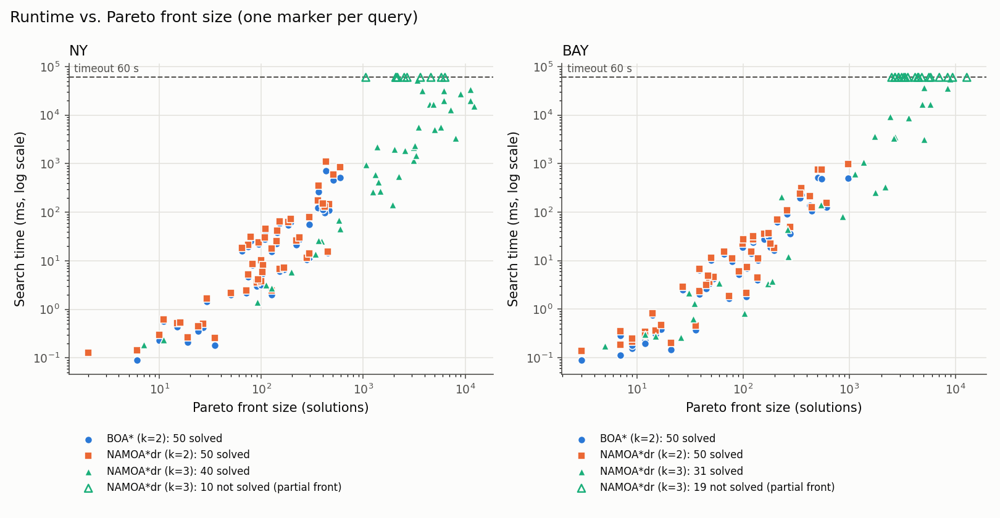
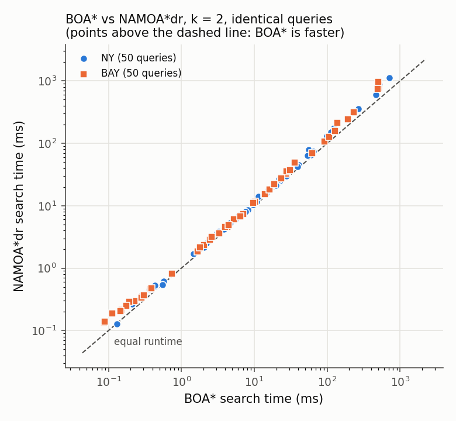

# multiobjective-search-cpp

Exact multi-objective shortest-path search on real road networks, in C++20:
**BOA\*** (bi-objective A\*) and **NAMOA\*dr** (multi-objective A\* with
dimensionality reduction), cross-checked against a simple label-setting
baseline and benchmarked on the 9th DIMACS Challenge road maps of New York
and the San Francisco Bay Area.

## The problem

In the *multi-objective shortest path* (MOSP) problem every arc has a vector
of k non-negative costs, e.g. distance and travel time. A path *dominates*
another if it is no worse in every objective and strictly better in at least
one. Unlike the single-objective case there is usually no single best path,
so the task is to compute the **Pareto front**: every non-dominated cost
vector (and one path achieving each) from a start to a goal. The front can
grow exponentially with the graph and even deciding whether a given path is
Pareto-optimal is hard, so practical algorithms live or die by how cheaply
they can discard dominated partial paths ("dominance checks").

## Algorithms

| Algorithm | Objectives | Where |
|---|---|---|
| BOA\* | 2 | [`include/mosp/boa_star.hpp`](include/mosp/boa_star.hpp), [`src/boa_star.cpp`](src/boa_star.cpp) |
| NAMOA\*dr | 2, 3 | [`include/mosp/namoa_dr.hpp`](include/mosp/namoa_dr.hpp), [`src/namoa_dr.cpp`](src/namoa_dr.cpp) |
| Martins-style label setting (reference) | 2, 3 | [`include/mosp/martins.hpp`](include/mosp/martins.hpp), [`src/martins.cpp`](src/martins.cpp) |

**BOA\*** follows Algorithm 3 of Hernández et al. (2023). OPEN is ordered
lexicographically by (f1, f2). For each state s it keeps a single number,
g2_min(s), the smallest g2 of any path expanded at s. Because paths reach a
state in non-decreasing g1 order, a new path to s is dominated exactly when
g2 ≥ g2_min(s), and a path cannot lead to a new solution when
f2 ≥ g2_min(goal). Both checks are O(1) and are applied when a node is
generated and again (lazily) when it is extracted. No per-state label sets
are stored.

**NAMOA\*dr** follows Pulido, Mandow & Pérez-de-la-Cruz (2015); the
bi-objective case matches Algorithm 2 of Hernández et al. (2023), and the
same structure is used for k = 3. OPEN is lexicographic in f. Paths expanded
at s (G_cl(s)) and solutions are compared using *truncated* vectors
(objectives 2..k), which is valid because of the lexicographic order:
a set of non-dominated truncated vectors per state (a single g2_min(s) when
k = 2). Open paths at s (G_op(s)) are compared with full k-dimensional
dominance, and open paths dominated by a new one are removed eagerly. That
linear scan over G_op(s) is exactly what BOA\* avoids.

**Martins-style label setting** extracts labels in lexicographic g order
over the whole graph, with a full pairwise dominance scan against each
node's permanent labels and no heuristic. It is slow and deliberately
simple; its only job is to be obviously correct.

All three return the *cost-unique* Pareto front: one path per Pareto-optimal
cost vector.

### References

- C. Hernández, W. Yeoh, J. A. Baier, H. Zhang, L. Suazo, S. Koenig, O. Salzman.
  *Simple and efficient bi-objective search algorithms via fast dominance checks.*
  Artificial Intelligence 314 (2023) 103807.
  [doi:10.1016/j.artint.2022.103807](https://doi.org/10.1016/j.artint.2022.103807)
- C. Hernández Ulloa, W. Yeoh, J. A. Baier, H. Zhang, L. Suazo, S. Koenig.
  *A Simple and Fast Bi-Objective Search Algorithm.* ICAPS 2020, pp. 143–151
  (the conference version introducing BOA\*).
  [doi:10.1609/icaps.v30i1.6655](https://doi.org/10.1609/icaps.v30i1.6655)
- F.-J. Pulido, L. Mandow, J.-L. Pérez-de-la-Cruz.
  *Dimensionality reduction in multiobjective shortest path search.*
  Computers & Operations Research 64 (2015) 60–70.
  [doi:10.1016/j.cor.2015.05.007](https://doi.org/10.1016/j.cor.2015.05.007)
- L. Mandow, J. L. Pérez de la Cruz. *Multiobjective A\* search with consistent
  heuristics.* Journal of the ACM 57(5), 2010 (NAMOA\*).
  [doi:10.1145/1754399.1754400](https://doi.org/10.1145/1754399.1754400)
- E. Q. V. Martins. *On a multicriteria shortest path problem.*
  European Journal of Operational Research 16(2) (1984) 236–245.
  [doi:10.1016/0377-2217(84)90077-8](https://doi.org/10.1016/0377-2217(84)90077-8)
- 9th DIMACS Implementation Challenge: Shortest Paths.
  <http://www.diag.uniroma1.it/challenge9/>

## Implementation notes

- **Graph.** Compressed sparse row (CSR) adjacency: `offsets[n+1]`,
  `heads[m]`, and the k costs of each arc stored contiguously so one arc's
  cost vector is a single load. A reversed copy is built for the heuristics.
- **Objectives.** k = 2 uses distance (`USA-road-d.<MAP>.gr`) and travel time
  (`USA-road-t.<MAP>.gr`); the loader checks that both files have the same
  arcs. k = 3 adds hop count (cost 1 per arc), as is common in the MOSP
  literature.
- **Heuristic.** For each objective, an exact backward Dijkstra from the goal
  on the reversed graph: h_i(u) is the cheapest u→goal cost in objective i.
  It is admissible and consistent, as both algorithms require. It is
  computed per query, and its time is reported separately from search time.
- **Memory.** Labels live in one contiguous pool per search object, cleared
  (not freed) between queries; OPEN is a binary heap of small
  `{f-vector, label index}` entries. NAMOA\*dr's per-state G_op and G_cl sets
  are intrusive linked lists threaded through the label pool, so the search
  loop makes no per-label or per-state heap allocations after warm-up.
- **Costs** are 32-bit. Every stored label is a simple path, so g is bounded
  by the total arc cost; each search checks per query that
  total + max finite h fits, and refuses the query otherwise.
- **Limits.** Each query has a wall-clock timeout and a label limit
  (`--max-labels`, default 40 million); hitting either is reported as
  `timeout` / `memout` and is never averaged into runtimes.

## Correctness testing

`ctest` runs the GoogleTest suite (`tests/`), also in CI on every push with a
Release build and a Debug build under AddressSanitizer and
UndefinedBehaviorSanitizer:

- DIMACS parsing, CSR layout, graph reversal and arc matching across files.
- Heuristics equal forward Dijkstra from every node and are consistent on
  every arc (random graphs, including zero-cost arcs).
- Hand-built graphs with fronts worked out by hand: diamonds, dominated and
  equal-cost routes, unreachable goals, start = goal, zero-cost cycles and
  self-loops, parallel arcs, a 16-point front from a chain of diamonds, and
  3-objective cases with ties in the first objective.
- The Martins baseline matches brute-force enumeration of all simple paths
  on 2,000 random graphs of up to 8 nodes (k = 2 and 3).
- BOA\* and NAMOA\*dr (k = 2) and NAMOA\*dr (k = 3) match Martins exactly
  on 1,000 random graphs (10–60 nodes, random or conflicting costs,
  zero-cost arcs, parallel arcs, many ties) and on 70 random grids with
  conflicting costs whose fronts reach hundreds of solutions.
- Every returned solution is checked structurally: sorted, mutually
  non-dominated, and backed by a simple start→goal path whose arc costs sum
  to the reported vector.

`MOSP_STRESS=20 ./build/mosp_tests` runs 20× as many random instances
(locally this covered 10,000 random graphs per k and 1,400 grids with
fronts of up to 1,370 solutions, all matching).

## Build, data, tests

Requirements: CMake ≥ 3.20, a C++20 compiler (tested with GCC 11), curl.
GoogleTest is fetched by CMake.

```bash
cmake -S . -B build -DCMAKE_BUILD_TYPE=Release    # -O3 -march=native
cmake --build build -j
ctest --test-dir build --output-on-failure
```

Road networks are not committed. Download NY and BAY (distance, travel
time and coordinates) into `data/`:

```bash
scripts/download_data.sh            # or: scripts/download_data.sh NY BAY COL ...
```

The script checks the header sizes and verifies NY and BAY against the
SHA-256 sums in [`scripts/dimacs.sha256`](scripts/dimacs.sha256). If the
challenge site is unreachable, put the files (optionally `.gz`) into
`data/` by hand and re-run the script to unpack and verify them.

## Benchmark

```bash
./build/mosp_bench --map NY --algo boa   --objectives 2 --queries 50 --seed 1 --timeout 60
./build/mosp_bench --map NY --algo namoa --objectives 3 --queries 50 --seed 1 --timeout 60
scripts/run_benchmarks.sh 50 60 1         # everything below: NY and BAY, all configurations

python3 -m venv .venv && .venv/bin/pip install -r scripts/requirements.txt
.venv/bin/python scripts/summarize.py     # results/summary.md + plots
```

Queries are uniformly random (start, goal) pairs, kept only if the goal is
reachable, drawn from a `mt19937_64` seeded with `--seed`. They depend only
on the seed and the map, so every algorithm and objective count is run on
exactly the same queries. Each run writes one CSV row per query
(`results/<MAP>_<algo>_k<k>.csv`) with status, Pareto-front size, search
time, heuristic time, expansions and generated nodes. `--crosscheck` (k = 2)
also runs the other algorithm and fails if the fronts differ.

## Results

**Setup.**
- **Machine:** Intel Core i7-12700 (12th Gen), Linux 6.8, GCC 11.4.0.
- **Build:** Release, `-O3 -march=native`.
- **Runs:** single-threaded, one configuration at a time. Commit and command are in [`results/system.txt`](results/system.txt).
- **Queries:** 50 random reachable queries per map (seed 1), with a 60 s timeout per query.
- **Maps:**

| Map | Nodes | Arcs |
|---|---:|---:|
| NY (New York City) | 264,346 | 733,846 |
| BAY (San Francisco Bay Area) | 321,270 | 800,172 |

The table and plots are produced by `scripts/summarize.py` from the CSVs in [`results/`](results/). Runtime, front size, expansions and generated nodes are over **solved queries only**. Timeouts are counted separately, never averaged in. Runtime is search time only. The exact heuristic (k backward Dijkstras) takes an additional ~30–34 ms per query for k = 2 and ~48–62 ms for k = 3 (column `heuristic_ms` in the CSVs).

| Map | Algorithm | k | Solved | Timeouts (> 60 s) | Front size mean / median / max | Runtime ms mean / median / max | Expansions (mean) | Generated (mean) |
|---|---|---:|---:|---:|---|---|---:|---:|
| NY | BOA\* | 2 | 50 / 50 | 0 | 165.7 / 106 / 593 | 60.4 / 11.1 / 710 | 350,334 | 471,996 |
| NY | NAMOA\*dr | 2 | 50 / 50 | 0 | 165.7 / 106 / 593 | 85.1 / 12.8 / 1,121 | 350,334 | 438,874 |
| NY | NAMOA\*dr | 3 | 40 / 50 | **10** | 3,355 / 2,396 / 12,149 | 7,927 / 1,688 / 52,932 | 3,157,824 | 3,935,152 |
| BAY | BOA\* | 2 | 50 / 50 | 0 | 151.3 / 85 / 983 | 55.5 / 6.7 / 510 | 357,883 | 451,178 |
| BAY | NAMOA\*dr | 2 | 50 / 50 | 0 | 151.3 / 85 / 983 | 81.9 / 7.1 / 971 | 357,883 | 426,680 |
| BAY | NAMOA\*dr | 3 | 31 / 50 | **19** | 1,951 / 868 / 8,873 | 6,377 / 206 / 56,254 | 2,543,013 | 2,856,464 |

No query hit the label limit (memout). The largest k = 3 search stored 21.8 million labels.





### BOA\* vs NAMOA\*dr at k = 2

Both algorithms returned identical Pareto fronts on all 100 queries: `--crosscheck` compared every front vector by vector. BOA\* was faster on 98 of the 100 queries.

| Map | Median speedup | Geometric mean | Range | Total search time ratio | Median speedup, queries where BOA\* needs ≥ 100 ms |
|---|---:|---:|---|---:|---:|
| NY | 1.16× | 1.19× | 0.98×–1.65× | 1.41× | 1.35× (7 queries) |
| BAY | 1.20× | 1.25× | 1.05×–1.94× | 1.48× | 1.43× (8 queries) |

- **Where the time goes.** Both algorithms expanded exactly the same number of labels on 99 of the 100 queries, and the remaining one is nearly equal. The difference is therefore the cost *per label*, not the amount of search.
  - NAMOA\*dr scans and maintains the open set G_op(s) on every generated label and keeps its linked lists up to date.
  - BOA\* does two O(1) comparisons against g2_min.
  - BOA\* generates about 6–8 % *more* labels, because it prunes lazily instead of deleting dominated open labels eagerly, and it is still faster.
  - The advantage grows with the size of the search.
- **Consistent with the published results.** Hernández et al. (2023, Table 4) report BOA\* at 1.2× (NY) and 1.3× (BAY) the speed of NAMOA\*dr, by mean runtime. Their runtimes include the heuristic, and their 50 instances differ from ours. They also report BOA\* generating about 1.04× more nodes. On these two maps, the gap they find is small too, growing with front size (2.2× on Florida). Their larger, order-of-magnitude gaps are against other algorithms, such as BOA\* with linear-time dominance checks and the bi-objective Dijkstra variants.

  These are two maps with moderate fronts. The ratio should be expected to change on larger maps or with less correlated objectives.
- **The heuristic matters at this scale.** For the median query, BOA\*'s search (7–11 ms) is cheaper than computing the exact heuristic (~30 ms of backward Dijkstra). End-to-end, easy queries are dominated by preprocessing, not by dominance checks.

### Two vs. three objectives

Adding hop count as a third objective makes the problem dramatically harder.

| Map | Queries solved at k=2 / at k=3 | Median front, k=2 → k=3 | Median per-query front ratio k3/k2 | Median per-query runtime ratio k3/k2 |
|---|---|---|---:|---:|
| NY | 50 / 40 | 93.5 → 2,396 | 24× | 132× |
| BAY | 50 / 31 | 39 → 868 | 20× | 138× |

These ratios cover only the queries solved at both k = 2 and k = 3, so they understate the growth:
- **The timeouts are the hard queries.** The k = 3 timeouts are exactly the queries with the largest k = 2 fronts: a median k = 2 front of 382 (NY) and 210 (BAY), against 93.5 and 39 for the queries solved at k = 3.
- **Their fronts are already huge.** When stopped at 60 s, these searches had found partial fronts of 1,060–6,338 (NY) and 2,511–12,788 (BAY) solutions. These are lower bounds on the true front sizes.
- **Every dominance check got more expensive.** The truncated closed sets are no longer a single number per state, and full 3-dimensional checks are needed against the open sets.

Hop count is fairly correlated with distance, so a less correlated third objective would likely make the blow-up worse.

**Reproducing.** `scripts/run_benchmarks.sh 50 60 1` followed by `.venv/bin/python scripts/summarize.py` regenerates everything in `results/`. Runtimes will differ on other machines; front sizes, expansions and generated counts are deterministic for a given seed. A single query may differ slightly in expansions if heap ties break differently.

### Data provenance

The official challenge site was unreachable from the benchmark machine when these results were produced (2 November 2026). The six files were taken from public GitHub copies used by other shortest-path projects, then verified:
- **Headers:** the original challenge headers and comments, with the published node and arc counts.
- **Edge counts:** the number of distinct (u, v) pairs is 730,100 (NY) and 794,830 (BAY). These match the edge counts reported for these maps by Hernández et al. (2023).
- **Distance vs. time files:** identical arc lists in the same order.
- **Coordinates:** inside the NY and Bay Area bounding boxes.
- **NY archives:** they carry their original 2006 gzip timestamps.

Their SHA-256 sums are in [`scripts/dimacs.sha256`](scripts/dimacs.sha256), and `download_data.sh` checks them.

## Possible extensions

Not implemented here:

- **Bidirectional bi-objective search (BOBA\*)**: run BOA\*-style searches
  from both ends with different objective orderings (S. Ahmadi, G. Tack,
  D. Harabor, P. Kilby, *Bi-Objective Search with Bi-Directional A\**,
  ESA 2021, LIPIcs 204, 3:1–3:15).
- **Parallel multi-objective A\***: partition the work of expanding and
  pruning labels across threads while keeping dominance checks consistent.
- **Negative-weight MOSP**: arc costs that can be negative (e.g. energy
  recuperation for electric vehicles), where label-setting assumptions and
  consistent heuristics no longer hold directly.
- **Resource-constrained shortest paths**: minimise one cost subject to
  budgets on the others, using the same dominance machinery with
  bound-based pruning.
- **Preprocessing**: contraction hierarchies or graph partitioning adapted
  to multiple objectives, to shrink the search space of each query.

## License

MIT; see [LICENSE](LICENSE).
